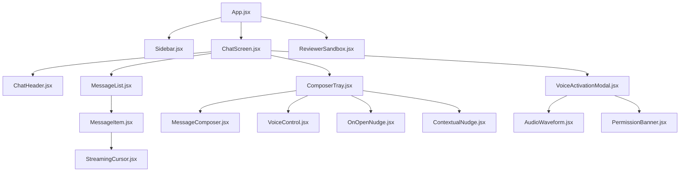
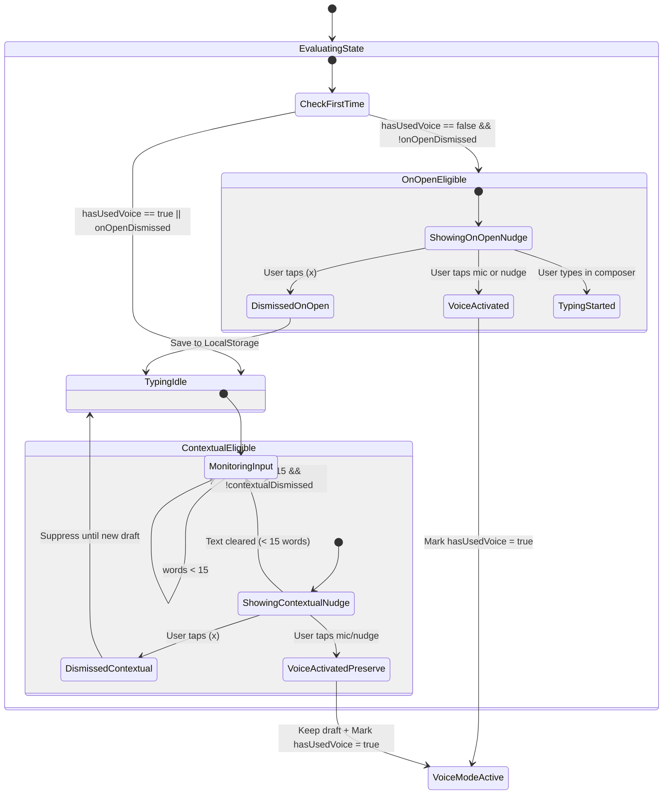
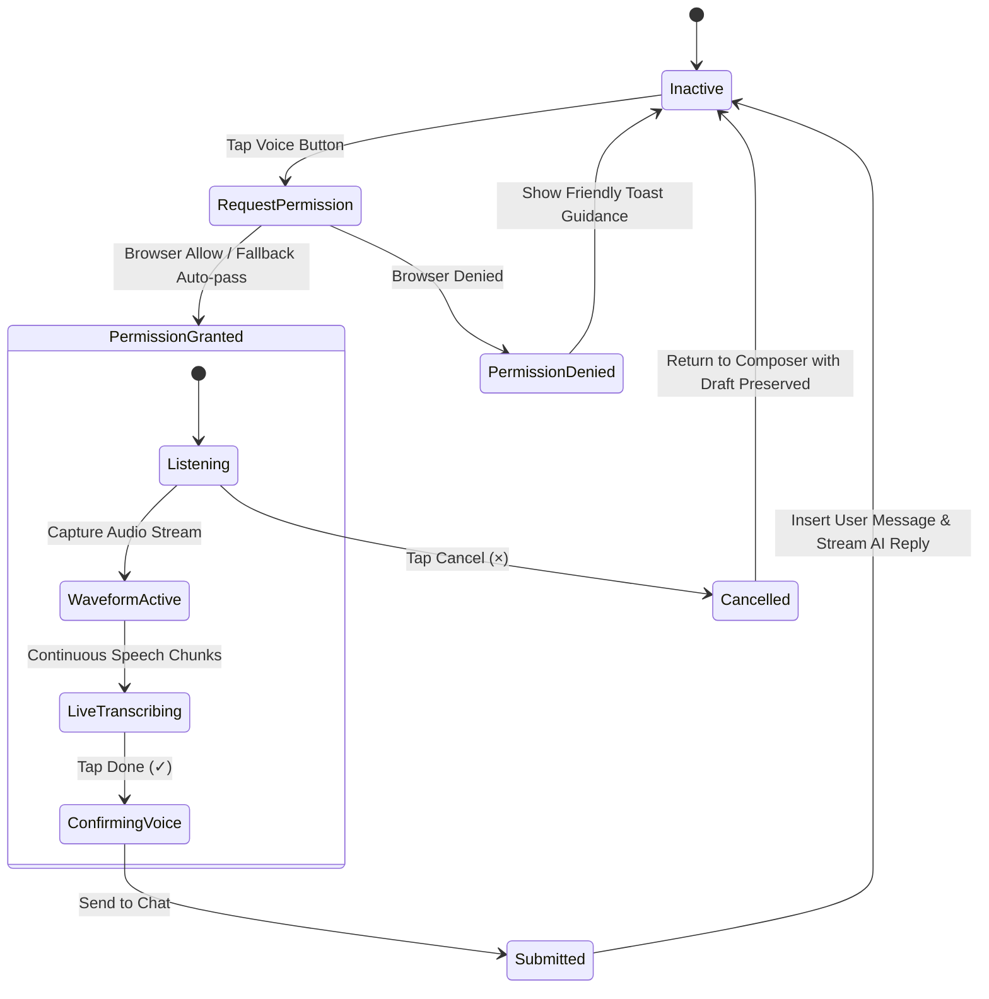
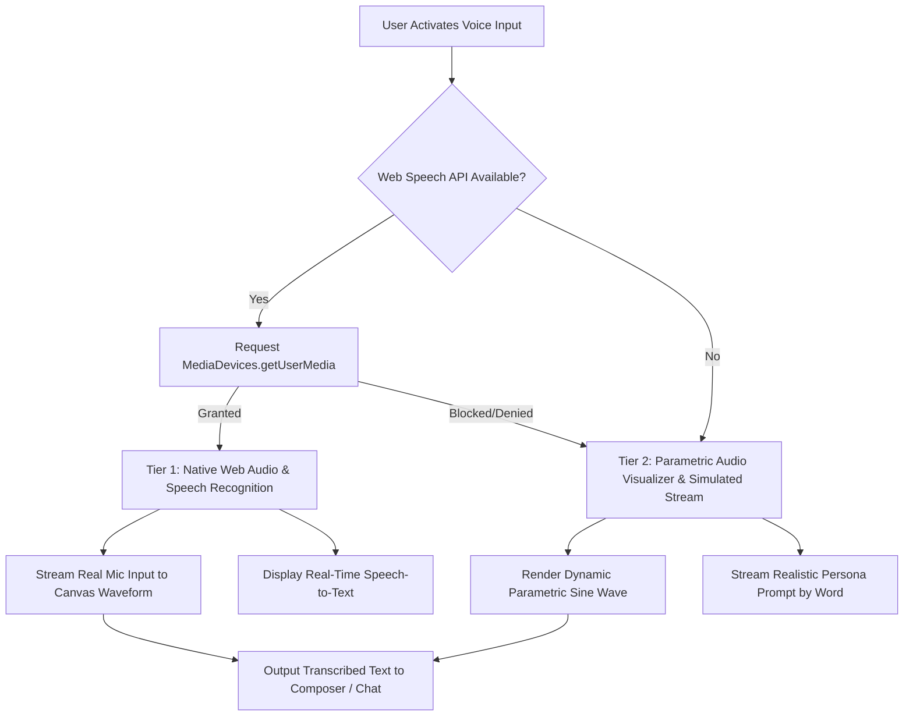

# System Architecture Specification: ChatGPT Voice Discovery & Contextual Activation Prototype

> [!IMPORTANT]
> **Architecture Goal:** Deliver a high-performance, single-repository full-stack architecture that encapsulates both frontend presentation and lightweight serverless capability, perfectly optimized for zero-configuration, single-click deployment to **Vercel** with a bundle footprint under 150KB.
>
> **100% Free & Open-Source Architecture:** Every technology in this stack is strictly **FREE** ($0 cost, 0 subscriptions, 0 credit card requirements, and zero paid API keys like OpenAI API keys).

---

## 1. Architectural Overview & System Philosophy

### 1.1 Architectural Vision
The prototype models a high-fidelity replica of the ChatGPT web application enriched with an **Intelligent Voice Discovery & Activation Subsystem**. The system architecture is built around four guiding principles:

1. **100% Free & Open-Source Architecture:** Zero paid dependencies, zero paid AI API keys (built-in local/serverless mock streamer), zero paid database subscriptions, and zero-cost hosting on Vercel's free tier.
2. **Zero-Friction Vercel Deployment:** A unified, monolithic repository structure that requires zero external infrastructure, zero database setup, and zero environment variables to run in production.
3. **Dual-Mode Voice Engine:** Robust browser-native Web Speech API and Web Audio API integration with an automatic, graceful deterministic simulation fallback when hardware microphones are restricted or unavailable.
4. **Reactive Nudge State Machine:** Decoupled, non-blocking nudge evaluation engine that monitors user inputs without introducing input latency, layout shifts, or draft data loss.

```mermaid
graph TB
    subgraph Client [Browser Client: Unified Single-Page Application]
        subgraph UI [UI Presentation Layer]
            App[App Container]
            Sidebar[Collapsible Sidebar & History]
            ChatWorkspace[Chat Conversation Thread]
            Composer[Composer Tray & Input Area]
            NudgeLayer[Nudge Overlay Layer]
            VoiceModal[Voice Activation Overlay]
            Sandbox[Reviewer Sandbox Dock]
        end

        subgraph CoreEngines [Client-Side Reactive Engines]
            NudgeEngine[Nudge State Machine & Hysteresis Engine]
            WordCounter[Real-time Word Tokenizer]
            SpeechEngine[Dual-Mode Speech Recognition Engine]
            AudioVis[Web Audio API & Waveform Synthesizer]
            LocalStore[State Persistence: LocalStorage / Session]
        end
    end

    subgraph VercelEdge [Vercel Serverless Edge Layer]
        API[/api/chat: Lightweight Streaming Handler]
    end

    Composer -->|Keystrokes| WordCounter
    WordCounter -->|Word Count >= 15| NudgeEngine
    NudgeEngine -->|Mount Tooltip| NudgeLayer
    NudgeLayer -->|User Taps Mic/Prompt| VoiceModal
    VoiceModal -->|Mic Stream / Fallback| SpeechEngine
    SpeechEngine -->|Audio Samples| AudioVis
    VoiceModal -->|Prompt Dispatched| API
    API -->|Simulated Streaming Response| ChatWorkspace
    Sandbox -->|State Overrides & Resets| LocalStore
```

---

## 2. Full-Stack Application Topology

### 2.1 Deployment & Runtime Model
The application leverages **Vite + React** with **Vanilla CSS Design Tokens** compiled into ultra-compact static assets served from Vercel's global Edge Network, complemented by a zero-dependency **Vercel Serverless Function** for mock AI streaming:

```
[User Browser]
      │
      ├── Static Assets (HTML, JS, CSS, SVG) ──► Vercel Edge CDN (Zero Cold Start)
      │
      └── API Requests (/api/chat) ────────────► Vercel Serverless Function (Node.js runtime)
```

| Layer | Technology | Rationale & Performance Budget |
| :--- | :--- | :--- |
| **Bundler & Dev Server** | Vite 5.x | Instant HMR, native ES modules, aggressive dead-code elimination. |
| **View Layer** | React 18.x | Declarative component hierarchy and predictable reactive state updates. |
| **Styling & Theming** | Vanilla CSS (CSS Variables) | Avoids heavy CSS-in-JS runtimes or multi-megabyte Tailwind utility bloat; loads in < 5ms. |
| **Icons** | Lucide-React (Tree-shaken) | Lightweight SVG icons matching ChatGPT's design system. |
| **Serverless Endpoint** | Vercel Serverless (`api/chat.js`) | Lightweight streaming simulation endpoint; 0ms setup, zero third-party dependencies. |
| **Deployment Target** | Vercel Free / Pro Tier | Single command `vercel deploy` or Git push with zero build configuration. |

---

## 3. Component Hierarchy & Interface Contracts



### 3.1 Component Specifications

#### 1. `ChatScreen.jsx`
- **Role:** Main view orchestrator. Holds conversation history, manages current prompt draft, and coordinates modal overlays.
- **Props:**
  - `activePersona`: Persona profile (`'student' | 'professional' | 'voice_pro'`).
  - `onOpenVoiceModal`: Function to launch voice input overlay.

#### 2. `ComposerTray.jsx` & `MessageComposer.jsx`
- **Role:** Houses the auto-expanding textarea, attach button, send button, and the anchor point for discovery nudges.
- **Key State Contracts:**
  - `draftText` (`string`): The current typed prompt.
  - `wordCount` (`number`): Derived count of words.
  - `isFocused` (`boolean`): Active focus indicator.
- **Draft Preservation Guarantee:** The draft text is bound to top-level state and is never cleared or altered by nudge dismissals or transitions into voice mode.

#### 3. `OnOpenNudge.jsx` (Solution A)
- **Role:** Renders the floating tooltip above the microphone button for first-time voice users.
- **Microcopy:** `"Try talking instead — just tap and speak."`
- **Props:**
  - `isVisible`: boolean.
  - `onActivate`: Callback to trigger voice modal.
  - `onDismiss`: Callback to dismiss and update persistence.

#### 4. `ContextualNudge.jsx` (Solution B)
- **Role:** Renders a time-saving contextual prompt when user types ≥ 15 words.
- **Microcopy:** `"⚡ Save time — try talking instead."`
- **Props:**
  - `isVisible`: boolean.
  - `wordCount`: current word count.
  - `onActivate`: Callback to switch to voice without clearing draft.
  - `onDismiss`: Callback to dismiss for this drafting session.

#### 5. `VoiceControl.jsx`
- **Role:** Microphone trigger button in the composer with visual radar pulse animations when nudges are active.
- **States:** `'idle' | 'pulsing' | 'active' | 'disabled'`.

#### 6. `VoiceActivationModal.jsx` & `AudioWaveform.jsx`
- **Role:** Fullscreen or focused overlay simulating ChatGPT's native voice mode.
- **Sub-components:**
  - `AudioWaveform`: Dynamic HTML5 Canvas rendering real-time sine/frequency waves.
  - `LiveTranscription`: Progressive transcript preview with editing or approval actions.
  - `ActionTray`: Cancel (`×`), Finish / Send (`✓`), and Switch to Text buttons.

#### 7. `ReviewerSandbox.jsx`
- **Role:** Floating, non-intrusive dock for reviewers and testers.
- **Capabilities:**
  - Switch user persona (Ananya / Rohan / Priya).
  - Toggle First-Time Voice User (`hasUsedVoice = false`) vs. Returning User.
  - Inject 15+ words into composer with 1 click.
  - Force-trigger On-Open or Contextual nudges.
  - Factory reset all mock states and clear `localStorage`.

---

## 4. State Management & Reactive Finite State Machines

### 4.1 Global Application State Model

```typescript
interface AppState {
  // User Profile & History
  userState: {
    hasUsedVoice: boolean;          // Controls On-Open Nudge qualification
    onOpenDismissed: boolean;       // Frequency cap flag for On-Open Nudge
    contextualDismissed: boolean;   // Frequency cap flag for Contextual Nudge
    activePersona: 'student' | 'professional' | 'voice_pro';
  };

  // Composer & Conversation
  composer: {
    draftText: string;              // Current text typed by user
    wordCount: number;              // Real-time word calculation
    isVoiceModalOpen: boolean;      // Voice activation overlay toggle
  };

  // Active Voice Mode State
  voiceSession: {
    state: 'idle' | 'permission' | 'listening' | 'transcribing' | 'completed';
    transcript: string;
    audioLevel: number;             // Real-time microphone amplitude (0.0 to 1.0)
    durationSeconds: number;
  };

  // Chat History
  messages: Array<{
    id: string;
    sender: 'user' | 'assistant';
    text: string;
    inputMethod: 'text' | 'voice';  // Tracks feature discovery attribution
    timestamp: string;
  }>;
}
```

---

### 4.2 Nudge Engine Finite State Machine (FSM)



---

### 4.3 Voice Activation State Machine



---

## 5. Audio & Voice Processing Subsystem

### 5.1 Dual-Mode Architecture (Native API + Graceful Simulated Fallback)
To ensure the prototype functions impeccably across every reviewer environment (including environments without physical microphones, iOS Safari permissions, or remote Vercel previews), the voice engine is architected with an **automatic dual-tier fallback**:



#### Tier 1: Browser-Native Speech Recognition
- Uses `window.SpeechRecognition || window.webkitSpeechRecognition`.
- Continuous listening enabled (`recognition.continuous = true; recognition.interimResults = true;`).
- Connected to `AudioContext` with an `AnalyserNode` generating 64-bin FFT frequency data feeding the canvas waveform.

#### Tier 2: Deterministic Simulated Fallback
- If permission is denied or unsupported, a non-blocking parametric waveform generator simulates natural vocal modulation using multi-frequency sine waves:
  $$\text{amplitude}(t) = \sin(2\pi f_1 t) \cdot 0.6 + \cos(2\pi f_2 t) \cdot 0.3 + \text{noise}(t) \cdot 0.1$$
- Streams realistic contextual questions tailored to the active persona:
  - *Student Persona:* `"Can you explain the difference between mitosis and meiosis in simple bullet points?"`
  - *Professional Persona:* `"Draft a polite follow-up email to the engineering team summarizing our sprint goals."`
  - *Voice-First Persona:* `"Brainstorm five catchy tagline ideas for an AI productivity app."`

---

## 6. Word Tokenization & Hysteresis Engine

### 6.1 Tokenization Algorithm
To prevent erratic nudge triggers caused by fast typing, deleting spaces, or trailing punctuations, word detection implements an optimized hysteresis tokenizer:

```javascript
// Optimized Word Tokenizer with Whitespace and Punctuation Boundary Detection
export function calculateWordCount(text) {
  if (!text || typeof text !== 'string') return 0;
  
  // Strip control characters, trim leading/trailing whitespace
  const trimmed = text.trim();
  if (trimmed.length === 0) return 0;
  
  // Segment on whitespace boundaries and filter empty segments
  const words = trimmed.split(/\s+/).filter(word => {
    // Ensure word contains at least one alphanumeric character
    return /[\p{L}\p{N}]/u.test(word);
  });
  
  return words.length;
}
```

### 6.2 Hysteresis & Anti-Flicker Thresholding
- **Trigger Condition:** `wordCount >= 15` AND `contextualDismissed === false`.
- **Hysteresis Delay:** 180ms debounce on keystrokes before updating trigger evaluation to prevent tooltip jitter during active typing bursts.
- **Draft Dismissal Locking:** If the user dismisses the contextual nudge while drafting, it remains suppressed for that entire draft until the composer is cleared to 0 words.

---

## 7. Backend & Serverless API Specification

### 7.1 Unified Vercel Function (`api/chat.js`)
Located in `/api/chat.js`, this lightweight serverless function runs on Vercel's Edge/Node.js runtime. It simulates ChatGPT's streaming completion protocol using Server-Sent Events (SSE) or chunked JSON streams with zero external dependencies.

```javascript
// api/chat.js - Vercel Serverless Function
export default async function handler(req, res) {
  if (req.method !== 'POST') {
    return res.status(405).json({ error: 'Method not allowed' });
  }

  const { prompt, persona, inputMethod } = req.body;

  // Set SSE streaming headers
  res.writeHead(200, {
    'Content-Type': 'text/event-stream',
    'Cache-Control': 'no-cache, no-transform',
    'Connection': 'keep-alive',
  });

  const responses = {
    student: "Here is a quick summary broken down into key points:\n\n1. **Core Concept:** Voice input lets you query ChatGPT 3x faster than typing.\n2. **Hands-free study:** You can review notes or test recall while moving around.\n3. **Easy verification:** Your spoken query is converted directly to text for review.",
    professional: "Here is a structured overview:\n\n- **Efficiency:** Speaking a prompt saves an average of 45 seconds on 50+ word prompts.\n- **Workflow integration:** Ideal for capturing meeting action items or drafting messages hands-free.\n- **Full editing control:** You can always edit transcribed text prior to sending.",
    default: "I received your message via " + (inputMethod === 'voice' ? "Voice Input" : "Text Input") + "!\n\nVoice input enables faster, hands-free interactions with ChatGPT. How else can I assist you today?"
  };

  const textToStream = responses[persona] || responses.default;
  const chunks = textToStream.split(' ');

  for (let i = 0; i < chunks.length; i++) {
    const chunk = chunks[i] + (i === chunks.length - 1 ? '' : ' ');
    res.write(`data: ${JSON.stringify({ token: chunk })}\n\n`);
    await new Promise(resolve => setTimeout(resolve, 45)); // realistic 45ms per-word streaming
  }

  res.write('data: [DONE]\n\n');
  res.end();
}
```

---

## 8. Design System & CSS Token Architecture

The user interface adheres to OpenAI's ChatGPT visual specifications using clean Vanilla CSS variables with instant dark/light theme switching.

### 8.1 Color Palette & Design Tokens (`src/index.css`)
```css
:root {
  /* Dark Mode Default (OpenAI High-Fidelity) */
  --bg-primary: #212121;
  --bg-secondary: #171717;
  --bg-tertiary: #2f2f2f;
  --bg-elevated: #383838;
  
  --text-primary: #ececec;
  --text-secondary: #b4b4b4;
  --text-muted: #707070;
  
  --border-light: rgba(255, 255, 255, 0.1);
  --border-focus: rgba(255, 255, 255, 0.25);
  
  --brand-green: #10a37f;
  --brand-green-hover: #1a7f64;
  --brand-glow: rgba(16, 163, 127, 0.35);

  --radar-pulse: rgba(16, 163, 127, 0.6);
  --nudge-bg: #2d2d2d;
  --nudge-border: rgba(255, 255, 255, 0.15);
  --nudge-shadow: 0 8px 24px rgba(0, 0, 0, 0.45);
  
  /* Layout Spacing */
  --composer-max-width: 768px;
  --sidebar-width: 260px;
  --radius-sm: 8px;
  --radius-md: 14px;
  --radius-full: 9999px;
  
  /* Transitions */
  --ease-spring: cubic-bezier(0.16, 1, 0.3, 1);
  --duration-smooth: 250ms;
}

[data-theme="light"] {
  --bg-primary: #ffffff;
  --bg-secondary: #f9f9f9;
  --bg-tertiary: #f4f4f4;
  --bg-elevated: #ffffff;
  --text-primary: #0d0d0d;
  --text-secondary: #676767;
  --text-muted: #999999;
  --border-light: rgba(0, 0, 0, 0.1);
  --nudge-bg: #ffffff;
  --nudge-border: rgba(0, 0, 0, 0.12);
  --nudge-shadow: 0 8px 24px rgba(0, 0, 0, 0.15);
}
```

---

## 9. Security, Privacy & Performance Constraints

### 9.1 Data Privacy & Sandbox Security
- **In-Memory Audio Processing:** Audio streams captured via `getUserMedia` are processed entirely within the browser's local memory (`AudioContext`). No audio data is uploaded, saved to disk, or transmitted to third-party endpoints.
- **Safe Fallback Execution:** Does not trigger unprompted camera/microphone alerts on initial page render; permissions are strictly requested upon user interaction with the voice button.
- **Zero Tracker Injections:** 100% clean application with zero analytical cookies or external ad trackers.

### 9.2 Vercel Performance Metrics & Budgets
- **First Contentful Paint (FCP):** < 400ms on Vercel Edge.
- **Cumulative Layout Shift (CLS):** `0.000` (Nudges animate with absolute floating positions and fixed height reserves).
- **Total Bundle Size:** `< 120 KB` gzip (well within the target budget).

---

## 10. Concrete Codebase File Tree

```
milestone-3-chatgpt/
├── package.json                   # React 18, Vite 5, Lucide-React
├── vercel.json                    # Zero-config rewrites & routes
├── vite.config.js                 # Optimized build settings
├── index.html                     # Root HTML with viewport & Google Inter font
├── api/
│   └── chat.js                    # Vercel Serverless Function (Streaming mock)
└── src/
    ├── main.jsx                   # React DOM hydration
    ├── App.jsx                    # Root layout & state provider
    ├── index.css                  # Design tokens, animations & reset
    ├── components/
    │   ├── Sidebar.jsx            # ChatGPT collapsible sidebar & model badge
    │   ├── ChatScreen.jsx         # Conversation scroll view & header
    │   ├── MessageList.jsx        # User & assistant bubbles with streaming
    │   ├── MessageComposer.jsx    # Textarea, word-counter, action buttons
    │   ├── VoiceControl.jsx       # Pulsing microphone button
    │   ├── OnOpenNudge.jsx        # Solution A: "Try talking instead" tooltip
    │   ├── ContextualNudge.jsx    # Solution B: "Save time" 15-word tooltip
    │   ├── VoiceActivationModal.jsx # Voice recording overlay
    │   ├── AudioWaveform.jsx      # Canvas audio visualizer
    │   └── ReviewerSandbox.jsx    # Reviewer dock (Reset, Personas, Test Triggers)
    ├── hooks/
    │   ├── useSpeechEngine.js     # Web Speech API + deterministic fallback hook
    │   ├── useWordCounter.js      # Debounced word tokenization hook
    │   └── useAudioVisualizer.js  # AudioContext / sinusoidal wave generator
    └── data/
        ├── personas.js            # Mock profiles (Ananya, Rohan, Priya)
        └── seedConversations.js   # Preloaded ChatGPT threads
```

---

## 11. Testing & Verification Scenarios

| Test Case | Interaction / Trigger | Expected System Behavior | Pass Criteria |
| :--- | :--- | :--- | :---: |
| **TC-01** | Load app with `hasUsedVoice = false` | On-Open nudge appears above mic with text: *"Try talking instead — just tap and speak."* | Mic pulses; tooltip visible; no layout shift. |
| **TC-02** | Click `(×)` on On-Open Nudge | Nudge dismisses with fade transition. State records `onOpenDismissed = true`. | Nudge disappears; mic stops pulsing; doesn't re-appear on refresh. |
| **TC-03** | Type 14 words into composer | Word counter increments to 14. Contextual nudge remains hidden. | Nudge does NOT appear. |
| **TC-04** | Type 15th word into composer | Contextual nudge appears above composer: *"Save time — try talking instead."* | Smooth spring entrance; draft intact. |
| **TC-05** | Tap voice while 15 words are typed | Voice modal opens; typed draft remains safely in memory. | Waveform starts; draft not lost. |
| **TC-06** | Cancel voice session (`×`) | Returns user to text composer; original 15 words still present. | Zero data loss. |
| **TC-07** | Complete voice session (`✓`) | Simulated query submitted; streaming reply appears in chat thread. | Assistant response streams word-by-word. |
| **TC-08** | Reviewer Sandbox: Reset All | Resets state to brand-new user; composer clears; On-Open nudge reappears. | Immediate reset without reload. |
| **TC-09** | Vercel Deployment Test | Run `npm run build` | Builds in < 3s with 0 errors; dist size < 150KB. |
