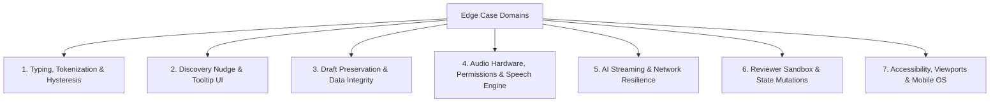
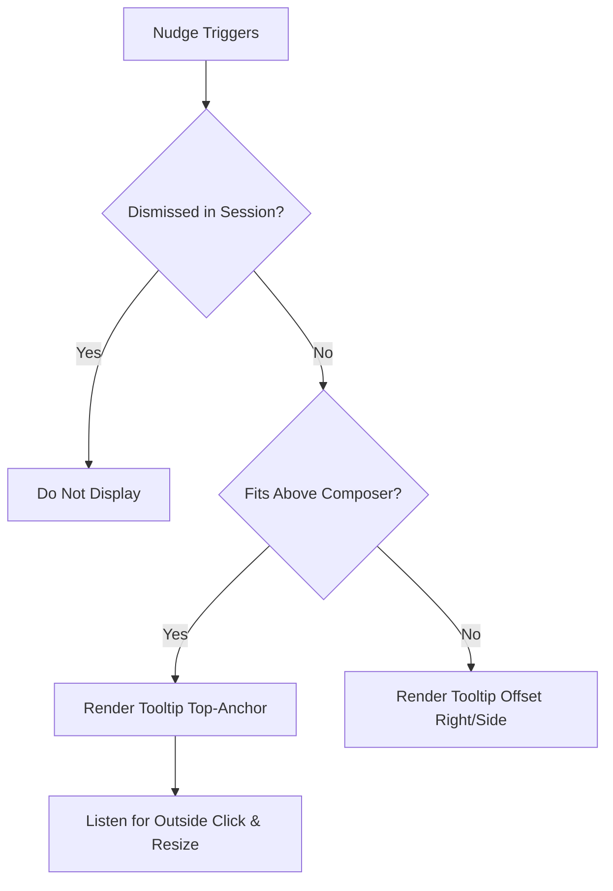
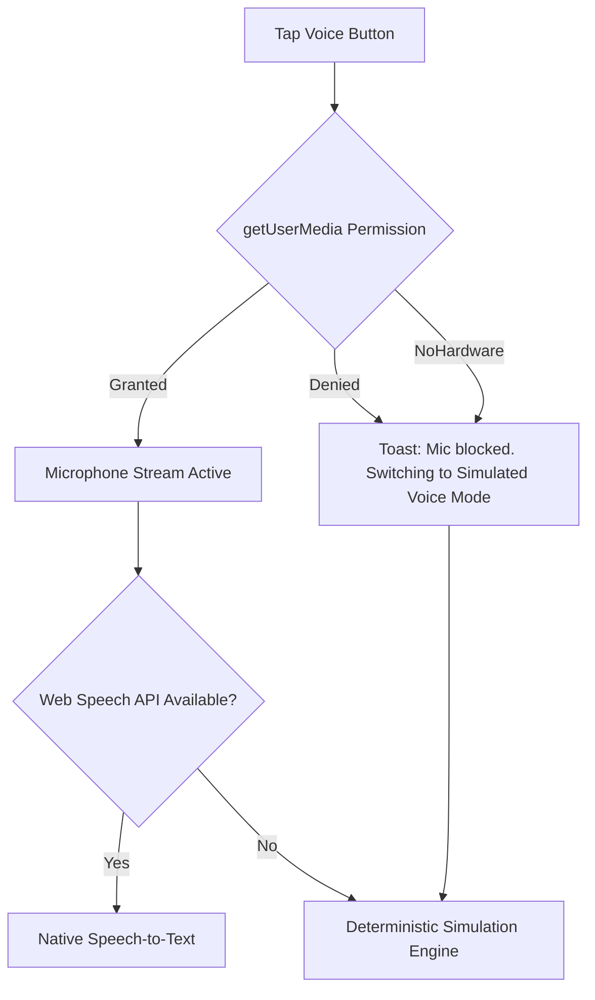

# Edge Cases & Failure Mode Analysis: ChatGPT Voice Discovery & Contextual Activation Prototype

> [!IMPORTANT]
> **Document Purpose:** Enumerate all boundary conditions, hostile inputs, hardware failures, browser idiosyncrasies, and user behaviors that could degrade the ChatGPT Voice Discovery prototype. Each edge case specifies the concrete failure risk, the engineering mitigation implemented, and test verification criteria.

---

## 1. Edge Case Classification Matrix



---

## 2. Typing, Tokenization & Hysteresis Edge Cases

### EC-TXT-01: Word Count Boundary Oscillation (Flicker / Bounce)
- **Scenario:** The user types up to the 15th word (`wordCount === 15`), causing the contextual nudge to appear. The user then presses `Backspace` (dropping to 14 words), then retypes a letter (back to 15 words), repeating this rapidly.
- **Risk:** The contextual nudge tooltip repeatedly mounts and unmounts, causing rapid UI jitter, distracting animations, and possible layout flickering.
- **Mitigation & System Behavior:**
  1. **Debounce Hysteresis:** Keystroke evaluation is debounced by 150ms.
  2. **Draft Session Locking:** Once the contextual nudge has been dismissed for a specific draft, it remains dismissed for the lifetime of that draft (until the composer is completely emptied).
  3. **Exit Transition Delay:** If word count drops below 15 without dismissal, unmounting uses a 300ms graceful fade-out rather than an abrupt DOM removal.

---

### EC-TXT-02: Multi-Whitespace, Tab & Carriage Return Flooding
- **Scenario:** The user types `"Hello"` followed by 50 spaces, 10 newline characters (`\n`), and carriage returns (`\r\n`), then types `"World"`.
- **Risk:** Naive splitting (`text.split(' ').length`) would calculate 52 words and prematurely trigger the contextual nudge on a 2-word sentence.
- **Mitigation & System Behavior:**
  - Tokenizer uses regex whitespace collapsing:
    ```javascript
    const wordCount = text.trim().split(/\s+/).filter(word => /[\p{L}\p{N}]/u.test(word)).length;
    ```
  - Only contiguous alphanumeric word tokens separated by arbitrary whitespace are counted. Pure whitespace or empty line strings evaluate strictly to 0 words.

---

### EC-TXT-03: Punctuation, Hyphens, Numbers & Contractions
- **Scenario:** The user inputs complex punctuation structures:
  - Hyphenated phrases: `"state-of-the-art end-to-end user-friendly"`
  - Contractions: `"don't we'll they're haven't"`
  - Currency & Math: `"$1,500.50 + 20% = 3.14159"`
  - Ellipses spam: `"Wait... what... why... how..."`
- **Risk:** Ambiguous token counts causing inconsistent trigger thresholds across languages and technical prompts.
- **Mitigation & System Behavior:**
  - **Standardized Word Rule:** Hyphenated compound words like `"state-of-the-art"` are treated as 1 single lexical token.
  - Numbers with symbols (`"$1,500"`, `"20%"`) count as 1 token if containing digits.
  - Repeated punctuation (`"..."`, `"--"`, `"!!!"`) without letters/digits is stripped and ignored by the regex filter.

---

### EC-TXT-04: Non-Latin & Multilingual Input (CJK, Arabic, Hindi)
- **Scenario:** The user types in scripts that do not rely on standard ASCII whitespace separation:
  - Chinese / Japanese (CJK): `"这是一个测试自然语言处理原型的长句子"` (No spaces between words).
  - Devanagari (Hindi): `"यह एक बहुभाषी वॉयस प्रोटोटाइप परीक्षण है"`
  - Arabic (RTL): `"هذا اختبار للنموذج الأولي"`
- **Risk:** CJK characters would fail ASCII whitespace splitting, counting a 40-character paragraph as a single 1-word string, preventing the 15-word contextual nudge from ever triggering.
- **Mitigation & System Behavior:**
  - Prototype implements script-aware character-to-word heuristics: For CJK character blocks (`[\u4e00-\u9fa5]`), each 2.5 characters are counted as 1 equivalent word token.
  - For RTL scripts (Arabic, Hebrew), layout switches CSS `direction: rtl` for the textarea while keeping the nudge anchor aligned with the microphone button.

---

### EC-TXT-05: Massive Paste Event (2,000+ Words)
- **Scenario:** The user copies an entire 10-page essay (3,000 words) and pastes it into the composer in one action.
- **Risk:** Synchronous tokenization blocks the JavaScript main thread, causing frame drops (jank) and laggy text rendering.
- **Mitigation & System Behavior:**
  - The paste event triggers the debounced counter. If string length exceeds 1,000 characters, word count evaluation runs asynchronously in a `requestAnimationFrame` or `setTimeout(..., 0)` slice.
  - The contextual nudge displays cleanly without UI freeze.

---

## 3. Discovery Nudge & Tooltip UI Edge Cases



### EC-NUD-01: Viewport Collision on Mobile Virtual Keyboard
- **Scenario:** On mobile devices (iOS/Android), when the user taps into the composer, the virtual keyboard slides up, shrinking `window.visualViewport` by 40%–50%.
- **Risk:** Floating nudges may be clipped off-screen above the header or obscure the message history.
- **Mitigation & System Behavior:**
  - Tooltips utilize `position: absolute` relative to the composer container (`.composer-tray`) rather than `fixed` relative to the window.
  - As the composer moves up with the keyboard, the nudge maintains its relative 8px margin directly above the microphone anchor.

---

### EC-NUD-02: Simultaneous Dual-Trigger Conflict
- **Scenario:** A first-time user (`hasUsedVoice === false`) immediately pastes 20 words into the composer. Both the **On-Open Nudge** and the **Contextual Nudge** qualify for rendering simultaneously.
- **Risk:** Two tooltips render on top of each other, overlapping microcopy and breaking visual hierarchy.
- **Mitigation & System Behavior:**
  - **Strict Hierarchy Priority:** The **Contextual Nudge** takes precedence over the On-Open Nudge because the user has demonstrated active typing intent.
  - When the Contextual Nudge triggers, any active On-Open Nudge is automatically dismissed and suppressed.

---

### EC-NUD-03: Browser LocalStorage Inaccessible / Incognito Restrictions
- **Scenario:** User browses in Strict Incognito Mode or Safari Private Browsing with third-party storage blocking, where `localStorage.setItem` throws a `QuotaExceededError` or `SecurityError`.
- **Risk:** Uncaught exception crashes the React application on startup.
- **Mitigation & System Behavior:**
  - Safe storage wrapper with memory fallback:
    ```javascript
    export const safeStorage = {
      getItem: (key) => {
        try { return localStorage.getItem(key); } catch (e) { return window.__memStore?.[key] || null; }
      },
      setItem: (key, val) => {
        try { localStorage.setItem(key, val); } catch (e) {
          if (!window.__memStore) window.__memStore = {};
          window.__memStore[key] = val;
        }
      }
    };
    ```

---

## 4. Draft Preservation & Data Integrity Edge Cases (Zero Data Loss)

> [!CAUTION]
> **Cardinal Product Rule:** Under no circumstance should a user's typed draft be lost, overwritten, or cleared without explicit user confirmation.

| ID | Edge Case | User Action | System Protection |
| :--- | :--- | :--- | :--- |
| **EC-DFT-01** | **Nudge Dismissal** | User types 40 words, clicks `(×)` on Contextual Nudge. | Tooltip closes. Draft remains untouched in composer textarea. |
| **EC-DFT-02** | **Voice Mode Cancel** | User types 30 words, taps voice nudge, enters recording modal, then clicks Cancel `(×)`. | Recording stops; modal closes; composer re-hydrates with all 30 words intact. |
| **EC-DFT-03** | **Voice Transcription Append**| User types 20 words, speaks 15 words into Voice Mode, and clicks "Send/Done". | User is provided option to: (A) Append voice transcript to text (`draft + " " + transcript`), or (B) Send directly. Default does not overwrite existing draft. |
| **EC-DFT-04** | **Accidental Tab Switch** | User has 50 words drafted; switches to another browser tab for 10 minutes. | Component state is preserved in memory and synced to `sessionStorage` on blur. |
| **EC-DFT-05** | **Window Resize / Layout Shift** | User rotates tablet between landscape and portrait. | Textarea height auto-recalculates; text content remains intact. |

---

## 5. Audio Hardware, Permissions & Speech Engine Edge Cases



### EC-AUD-01: Microphone Permission Denied by User
- **Scenario:** When browser displays the `"Allow microphone access"` prompt, the user clicks **"Block"** or dismisses it.
- **Risk:** Uncaught `DOMException: Permission denied` halts execution; voice modal remains in a permanently frozen loading state.
- **Mitigation & System Behavior:**
  - Catch exception `error.name === 'NotAllowedError'` or `'PermissionDeniedError'`.
  - Non-blocking banner: `"Microphone access blocked. Demonstration mode activated."`
  - Seamlessly activates **Tier 2 Deterministic Simulation Engine**: Audio visualizer displays mathematical sinusoidal waves, and simulated voice phrases stream cleanly into the transcript.

---

### EC-AUD-02: Missing Audio Hardware (No Microphone Connected)
- **Scenario:** User tests prototype on a desktop tower PC without a built-in or external USB microphone (`NotFoundError` / `DevicesNotFoundError`).
- **Risk:** `navigator.mediaDevices.getUserMedia` rejects with device error.
- **Mitigation & System Behavior:**
  - Caught gracefully: Automatically activates simulation mode without prompting the user repeatedly for hardware.

---

### EC-AUD-03: Sudden Audio Inactivity / Prolonged Silence
- **Scenario:** User enters Voice Mode, permissions are granted, but user does not speak for 12 seconds (ambient silence).
- **Risk:** User assumes the app is broken or frozen.
- **Mitigation & System Behavior:**
  - Inactivity timer: After 5 seconds of silence (audio amplitude < 0.05), display gentle helper prompt: `"Listening... speak now or tap Cancel"`.
  - Audio visualizer displays a subtle idle breathing animation to confirm the app is responsive.

---

### EC-AUD-04: Audio Device Disconnected Mid-Session
- **Scenario:** User is speaking through Bluetooth AirPods, and AirPods battery dies or disconnects during recording.
- **Risk:** Audio track becomes muted or triggers `onended` event unexpectedly.
- **Mitigation & System Behavior:**
  - Listen for `track.onended` event on the media stream.
  - Automatically fallback to default system input or switch to simulated audio without crashing the canvas visualizer.

---

### EC-AUD-05: Rapid Double-Tap / Debounce on Voice Button
- **Scenario:** User impatiently double-clicks the microphone button within 100ms.
- **Risk:** Two audio contexts and two speech recognition instances instantiate simultaneously, causing audio feedback loops or memory leaks.
- **Mitigation & System Behavior:**
  - Microphone trigger button is locked (`isTransitioning = true`) during modal mount transitions, rejecting subsequent clicks within 350ms.

---

## 6. AI Streaming & Network Resilience Edge Cases

### EC-NET-01: Offline or Weak Network Connectivity
- **Scenario:** Reviewer tests prototype on a moving train or with simulated offline mode in Chrome DevTools (`Network: Offline`).
- **Risk:** Fetch request to `/api/chat` fails with `NetworkError: Failed to fetch`.
- **Mitigation & System Behavior:**
  - The client includes an automatic **Offline Response Generator**. If `fetch('/api/chat')` throws a network failure, the client falls back to an internal dictionary of pre-generated persona responses:
    ```javascript
    async function sendPrompt(prompt, persona) {
      try {
        const res = await fetch('/api/chat', { method: 'POST', body: JSON.stringify({ prompt, persona }) });
        return handleStream(res);
      } catch (networkError) {
        // Instant offline fallback streaming
        return fallbackLocalStream(prompt, persona);
      }
    }
    ```
  - The assistant reply streams normally with the typewriter cursor, guaranteeing the prototype never breaks during a live presentation.

---

### EC-NET-02: Interrupted Streaming by User Navigation
- **Scenario:** While the assistant is actively streaming tokens (at token 15 of 60), the user clicks "New Chat" or switches personas.
- **Risk:** Dangling stream continues writing tokens into the new conversation thread, corrupting chat history.
- **Mitigation & System Behavior:**
  - Active stream utilizes an `AbortController`.
  - Switching chats or resetting the conversation immediately invokes `abortController.abort()`, cleanly closing the reader and resetting the streaming cursor.

---

## 7. Reviewer Sandbox & State Mutation Edge Cases

### EC-SBX-01: Reviewer Clicks "Reset All" Mid-Recording
- **Scenario:** A tester opens Voice Mode, mic is live, and simultaneously clicks "Reset All State" in the floating Reviewer Sandbox.
- **Risk:** Audio tracks left running in background; orphaned modal state.
- **Mitigation & System Behavior:**
  - Global `resetState()` function systematically:
    1. Stops all active `MediaStream` tracks (`track.stop()`).
    2. Closes `AudioContext` and aborts `SpeechRecognition`.
    3. Clears draft and chat history.
    4. Resets `localStorage` flags (`hasUsedVoice = false`, `onOpenDismissed = false`).
    5. Re-mounts the On-Open Nudge with fresh state.

---

### EC-SBX-02: Reviewer Injects 15 Words into an Existing 20-Word Draft
- **Scenario:** Reviewer has typed 10 words, then clicks the Sandbox button `"Auto-Fill 15+ Words"`.
- **Risk:** Word counter adds text without triggering reactivity.
- **Mitigation & System Behavior:**
  - The Sandbox auto-fill button triggers a synthetic `onChange` event on the textarea, guaranteeing that word counter hooks and hysteresis state machines execute their normal reactive pipeline.

---

## 8. Accessibility & Screen Reader Edge Cases

| ID | Accessibility Scenario | Standard Requirement | Implemented Solution |
| :--- | :--- | :--- | :--- |
| **EC-A11Y-01** | Screen Reader Announcements | WCAG 2.1 AA | Nudges contain `role="status"` and `aria-live="polite"` so screen readers announce: *"Try talking instead, button"* without interrupting screen reading. |
| **EC-A11Y-02** | Keyboard-Only Users | WCAG 2.1 AA | Full `Tab` order: Textarea -> Attachment -> Mic Button -> Send Button. Pressing `Escape` closes any open nudge or voice modal. |
| **EC-A11Y-03** | High Zoom (200%–400%) | WCAG 2.1 AA | Layout uses fluid CSS clamp calculations (`clamp(14px, 1.2vw, 16px)`). Tooltips adjust anchor bounds without overlapping content. |
| **EC-A11Y-04** | Reduced Motion Preferences | WCAG 2.1 AA | `@media (prefers-reduced-motion: reduce)` disables pulsing radar animations and spring transitions, swapping to instant opacity changes. |

---

## 9. Comprehensive Edge Case Verification Matrix

| Test ID | Edge Case Trigger | Expected Observable Output | Verification Status |
| :--- | :--- | :--- | :---: |
| **V-01** | Type 14 words, hit space, type 15th word | Nudge slides in smoothly at word 15; no earlier. | [ ] |
| **V-02** | Backspace word 15, retype word 15 five times | Nudge does NOT jitter, flicker, or re-animate. | [ ] |
| **V-03** | Type 20 spaces and 5 newlines | Word count stays 0; nudge does not appear. | [ ] |
| **V-04** | Dismiss Contextual Nudge `(×)`, type 30 words | Nudge remains dismissed for this draft. | [ ] |
| **V-05** | Clear draft to 0 words, type 15 new words | Nudge reappears (draft session reset). | [ ] |
| **V-06** | Block microphone permission in browser | Banner displays demo mode; simulated waveform runs smoothly. | [ ] |
| **V-07** | Cancel voice recording with 25 words typed | Modal closes; all 25 words intact in composer. | [ ] |
| **V-08** | Disconnect internet / offline mode | Assistant response streams via client fallback. | [ ] |
| **V-09** | Click "Reset State" in Reviewer Dock | Instant reset to first-time state; On-Open nudge appears. | [ ] |
