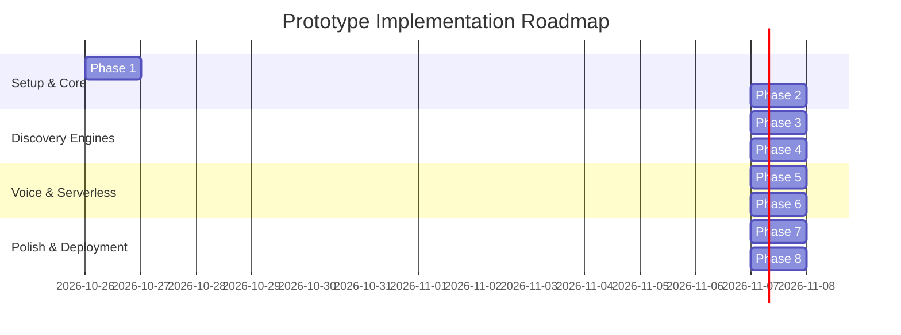
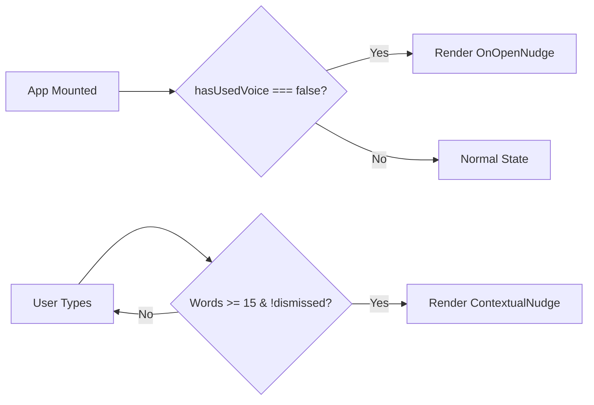
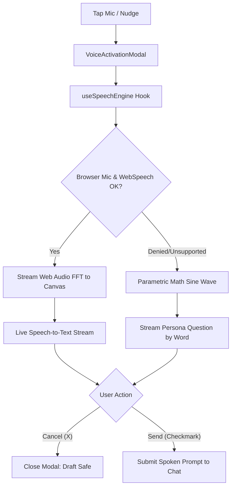

# Implementation Plan: ChatGPT Voice Discovery & Contextual Activation Prototype

> [!IMPORTANT]
> **Implementation Target:** Deliver a production-grade, single-repository full-stack prototype of ChatGPT with proactive and contextual voice discovery mechanisms. The codebase must be ultra-lightweight (< 150KB gzipped), feature zero external database dependencies, and deploy instantly to **Vercel** via zero-config setup.
>
> **100% Free & Open-Source Guarantee:** Every single technology, library, API, and platform chosen is completely **FREE** (zero dollar cost, zero subscriptions, zero paid API keys like OpenAI keys, and zero credit card requirements).

---

## 1. Project Overview & 100% Free Technology Stack



### 1.1 Free Technology Stack & Zero-Cost Breakdown

| Component | Technology | Cost / License | Why It's 100% Free |
| :--- | :--- | :--- | :--- |
| **View Layer** | React 18 | Free (MIT Open Source) | Zero licensing or subscription fees |
| **Tooling & Bundler** | Vite 5 | Free (MIT Open Source) | Completely free local developer tooling |
| **Styling & UI** | Vanilla CSS (CSS3) | Free (W3C Standard) | Native browser standard; $0 runtime cost |
| **Icons** | Lucide React | Free (ISC Open Source) | 100% free open-source vector icon set |
| **Speech-to-Text** | Web Speech API | Free (Browser Native) | Built into Chrome, Edge, Safari; $0 API fees |
| **Audio Visualizer** | Web Audio API + HTML5 Canvas | Free (W3C Standard) | Native browser audio processing; 0 cost |
| **AI Text Generation** | Local Mock Streamer / Serverless | Free (Local Code) | **No paid OpenAI API key needed**; completely self-contained |
| **State Persistence** | Browser `localStorage` | Free (HTML5 Standard) | No external paid database (Supabase/Firebase/Mongo) |
| **Typography** | Inter | Free (SIL Open Font License) | Free Google Font |
| **Cloud Hosting** | Vercel Hobby Tier | Free Forever | Unlimited personal projects, 0 credit card needed |

---

## 2. Phase-by-Phase Step-by-Step Implementation

### Phase 1: Project Scaffolding & Build Infrastructure

**Objective:** Initialize a clean, lightweight React + Vite project structure with Vercel configuration and design tokens.

- [ ] **Step 1.1: Initialize `package.json`**
  - Define dependencies: `react`, `react-dom`, `lucide-react`.
  - Define devDependencies: `@vitejs/plugin-react`, `vite`.
  - Set scripts: `"dev": "vite"`, `"build": "vite build"`, `"preview": "vite preview"`.
- [ ] **Step 1.2: Configure `vite.config.js`**
  - Set up standard React plugin.
  - Optimize bundle splitting (vendor chunking for React).
- [ ] **Step 1.3: Configure `vercel.json`**
  - Define SPA rewrite rule:
    ```json
    {
      "rewrites": [
        { "source": "/api/(.*)", "destination": "/api/$1" },
        { "source": "/(.*)", "destination": "/index.html" }
      ]
    }
    ```
- [ ] **Step 1.4: Create `index.html`**
  - Add viewport meta tags, dark mode background color meta, and Google Font (`Inter:wght@400;500;600;700`).
  - Set title: `"ChatGPT - Voice Discovery Prototype"`.
- [ ] **Step 1.5: Build `src/index.css` (Design System & Tokens)**
  - Establish complete CSS custom properties (`--bg-primary: #212121`, `--bg-secondary: #171717`, `--brand-green: #10a37f`, etc.).
  - Implement smooth transition utilities, keyframe animations (`radar-pulse`, `fade-in`, `slide-up`, `waveform-bounce`).

---

### Phase 2: ChatGPT Core Layout & Conversation Thread

**Objective:** Build the responsive ChatGPT interface shell with sidebar, model header, and message stream.

- [ ] **Step 2.1: Implement Mock Data (`src/data/seedConversations.js`)**
  - Preload realistic chat threads demonstrating student queries (Ananya) and professional tasks (Rohan).
- [ ] **Step 2.2: Build `src/components/Sidebar.jsx`**
  - Collapsible sidebar drawer with "New Chat" button, history items, user avatar, and persona indicator.
  - Mobile responsive toggle (hamburger icon).
- [ ] **Step 2.3: Build `src/components/ChatHeader.jsx`**
  - ChatGPT 4o model selector pill, sidebar toggle button, and active persona badge.
- [ ] **Step 2.4: Build `src/components/MessageList.jsx` & `MessageItem.jsx`**
  - Renders user prompt bubbles and ChatGPT assistant responses.
  - Supports Markdown formatting (bold, bullet points, code blocks).
  - Includes a visual indicator badge when a message was initiated via **"🎙️ Voice Input"** (proving feature attribution).
- [ ] **Step 2.5: Build `src/components/StreamingCursor.jsx`**
  - Blinking black/white pill cursor indicating active streaming AI generation.

---

### Phase 3: Composer Tray & Word Counter Engine

**Objective:** Create the message composer with dynamic auto-resize, voice button anchor, and hysteresis-backed word counting.

- [ ] **Step 3.1: Implement `src/hooks/useWordCounter.js`**
  - Real-time word calculation using unicode-aware boundary regex:
    ```javascript
    export function useWordCounter(text, debounceMs = 150) {
      // Returns { wordCount, isThresholdMet: wordCount >= 15 }
    }
    ```
  - Includes debounced state update to prevent tooltip flicker while typing rapidly.
- [ ] **Step 3.2: Build `src/components/MessageComposer.jsx`**
  - Auto-growing `<textarea>` that expands up to 200px and scrolls gracefully.
  - Action tray: Attachment icon, Voice microphone button, and Send button.
  - Keyboard handling: `Enter` to submit, `Shift+Enter` for newline.
- [ ] **Step 3.3: Implement Draft Preservation Logic**
  - Bind draft state to the main `ChatScreen` level so that navigating in/out of voice mode or dismissing tooltips never erases text.

---

### Phase 4: Discovery Nudge Subsystem (Solutions A & B)

**Objective:** Implement the proactive On-Open Nudge and the contextual 15-word typing nudge with frequency caps and dismissal mechanics.



- [ ] **Step 4.1: Build `src/components/OnOpenNudge.jsx` (Solution A)**
  - Positioned floating directly above the microphone button.
  - Microcopy: `"Try talking instead — just tap and speak."`
  - Subtle entrance spring animation with 400ms delay.
  - Dismiss `(×)` button that persists dismissal to `localStorage` / session state.
  - Clicking either the tooltip body or the mic opens the voice activation screen.
- [ ] **Step 4.2: Build `src/components/ContextualNudge.jsx` (Solution B)**
  - Anchored above the right edge of the composer tray.
  - Triggered dynamically when `wordCount >= 15`.
  - Microcopy: `"⚡ Save time — try talking instead."`
  - Dismiss `(×)` button that locks dismissal for the active draft (anti-spam guardrail).
- [ ] **Step 4.3: Build `src/components/VoiceControl.jsx`**
  - Microphone button with an animated radiating radar ring (`--radar-pulse`) when either nudge is active to guide user visual attention.

---

### Phase 5: Dual-Mode Audio & Voice Subsystem

**Objective:** Deliver an authentic voice recording overlay with real-time waveform visualization, speech transcription, and deterministic fallback.



- [ ] **Step 5.1: Implement `src/hooks/useSpeechEngine.js`**
  - Integrates `window.SpeechRecognition` / `webkitSpeechRecognition`.
  - Automatic fallback handler: If microphone permission is blocked or unsupported, automatically transitions to simulated speech streaming without throwing an unhandled exception.
- [ ] **Step 5.2: Implement `src/components/AudioWaveform.jsx`**
  - High-performance HTML5 `<canvas>` rendering 32 dynamic audio frequency bars or a smooth sinus curve.
  - Reacts to live microphone volume or simulated voice amplitude.
- [ ] **Step 5.3: Build `src/components/VoiceActivationModal.jsx`**
  - Darkened backdrop overlay matching ChatGPT's mobile/desktop voice modal.
  - Active recording status, elapsed time counter (`00:04`), and live transcript display.
  - Action buttons:
    - **Cancel (`×`):** Closes modal, restores user's typed draft without changes.
    - **Approve / Send (`✓`):** Dispatches the transcribed text directly to the chat conversation.
    - **Edit Text:** Transcribes audio back into composer `<textarea>` for manual editing.

---

### Phase 6: Vercel Serverless Function & Simulated AI Streaming

**Objective:** Implement single-repo serverless endpoint generating realistic streaming ChatGPT replies.

- [ ] **Step 6.1: Build `api/chat.js`**
  - Vercel Serverless Node.js handler.
  - Reads `prompt`, `persona`, and `inputMethod`.
  - Emits Server-Sent Events (SSE) or chunked streams at 40ms intervals to recreate ChatGPT's authentic typewriter effect.
  - Includes pre-tailored responses for academic (Ananya) and professional (Rohan) prompts.
- [ ] **Step 6.2: Implement Client-Side Streaming Consumer**
  - Reads SSE stream chunks via `ReadableStream` and updates the active message bubble token-by-token.
  - Includes offline fallback simulation so the app continues streaming even when previewed without a network connection.

---

### Phase 7: Reviewer Sandbox Dock & Persona Presets

**Objective:** Provide evaluators and stakeholders with quick testing tools to simulate first-time vs. returning users and inspect edge cases.

- [ ] **Step 7.1: Build `src/data/personas.js`**
  - Define Persona 1: **Ananya (Student)** - Focus on quick revision, flashcards, hands-free queries.
  - Define Persona 2: **Rohan (Multitasking Pro)** - Focus on drafting lengthy emails, project briefs, strategy.
  - Define Persona 3: **Priya (Commuter / Brainstormer)** - Voice-first ideation.
- [ ] **Step 7.2: Build `src/components/ReviewerSandbox.jsx`**
  - Collapsible floating dock in the bottom-left or top-right corner.
  - **Quick Persona Switcher:** Instantly switches chat context and suggested queries.
  - **First-Time vs Returning Toggle:** Toggles `hasUsedVoice` between `false` and `true`.
  - **Auto-Fill 15 Words Button:** Injects a 16-word prompt into the composer to immediately test the contextual nudge.
  - **Force Trigger Nudges:** Buttons to explicitly force On-Open or Contextual tooltips.
  - **Hard Reset Button:** Clears all local storage, restores default state, and restarts the flow.

---

### Phase 8: Testing, QA, Optimization & Vercel Deployment

**Objective:** Verify compliance with all acceptance criteria, optimize bundle size, and provide clear deployment steps.

- [ ] **Step 8.1: Run Bundle & Performance Audit**
  - Execute `npm run build`.
  - Verify total production bundle size is < 150KB gzipped.
  - Verify zero console errors and zero layout shifts.
- [ ] **Step 8.2: QA Verification Walkthrough**
  - Execute all 9 test cases from `architecture.md`.
  - Test responsiveness across mobile (375px), tablet (768px), and desktop (1440px).
- [ ] **Step 8.3: Vercel Deployment Verification**
  - Test locally with `vercel dev` or deploy directly with `vercel --prod`.

---

## 3. Concrete File Creation Checklist

```
milestone-3-chatgpt/
├── package.json                         # [Phase 1] Dependencies & scripts
├── vite.config.js                       # [Phase 1] Build & bundler config
├── vercel.json                          # [Phase 1] Vercel single-repo routes & rewrites
├── index.html                           # [Phase 1] HTML shell & fonts
├── api/
│   └── chat.js                          # [Phase 6] Vercel serverless streaming endpoint
└── src/
    ├── main.jsx                         # [Phase 1] React mount point
    ├── App.jsx                          # [Phase 2] Root state coordinator
    ├── index.css                        # [Phase 1] Design system & ChatGPT CSS tokens
    ├── data/
    │   ├── personas.js                  # [Phase 7] Persona data & presets
    │   └── seedConversations.js         # [Phase 2] Preloaded chat histories
    ├── hooks/
    │   ├── useWordCounter.js            # [Phase 3] Debounced word tokenization hook
    │   └── useSpeechEngine.js           # [Phase 5] Dual-mode speech & fallback hook
    └── components/
        ├── Sidebar.jsx                  # [Phase 2] Collapsible drawer & model switcher
        ├── ChatHeader.jsx               # [Phase 2] Top bar with model badge
        ├── ChatScreen.jsx               # [Phase 2] Conversation view & draft container
        ├── MessageList.jsx              # [Phase 2] Message bubble list
        ├── MessageItem.jsx              # [Phase 2] Individual chat bubble with voice tag
        ├── StreamingCursor.jsx          # [Phase 2] Typing cursor animation
        ├── MessageComposer.jsx          # [Phase 3] Dynamic auto-resizing textarea
        ├── VoiceControl.jsx             # [Phase 4] Microphone button with radar glow
        ├── OnOpenNudge.jsx              # [Phase 4] First-time discovery tooltip
        ├── ContextualNudge.jsx          # [Phase 4] 15-word threshold tooltip
        ├── VoiceActivationModal.jsx     # [Phase 5] Voice mode recording overlay
        ├── AudioWaveform.jsx            # [Phase 5] Canvas audio visualizer
        └── ReviewerSandbox.jsx          # [Phase 7] Floating reviewer demo panel
```

---

## 4. Verification & Acceptance Gate Matrix

| Gate | Phase | Criteria to Proceed | Validation Method |
| :---: | :--- | :--- | :--- |
| **G1** | Phase 1 & 2 | Clean ChatGPT dark theme renders; sidebar opens/closes; seed messages render cleanly. | Visual inspection on desktop & mobile viewport. |
| **G2** | Phase 3 | Typing into composer auto-expands textarea; word counter accurately logs words without lag. | Keystroke stress test; space and punctuation checks. |
| **G3** | Phase 4 | On-Open nudge shows for `hasUsedVoice = false` with correct copy; disappears on dismiss; contextual nudge appears at exactly 15 words; draft is never wiped. | Manual trigger tests and state inspection. |
| **G4** | Phase 5 | Voice modal opens; waveform responds dynamically; cancel returns to draft safely; approve submits text to chat. | Mic audio test and fallback simulation test. |
| **G5** | Phase 6 | Submitting prompt streams simulated assistant response with token-by-token cursor. | Network tab inspection and visual streaming check. |
| **G6** | Phase 7 & 8 | Reviewer sandbox toggles all states in 1 click; `npm run build` succeeds under 150KB; Vercel deploys with 0 configuration. | Build output verification and `vercel deploy`. |
