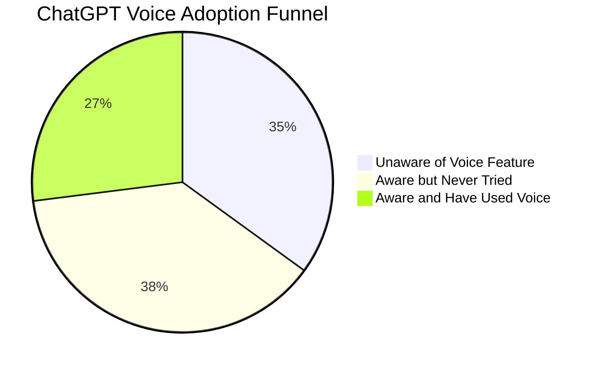
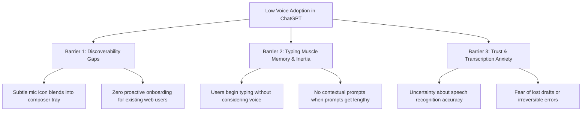
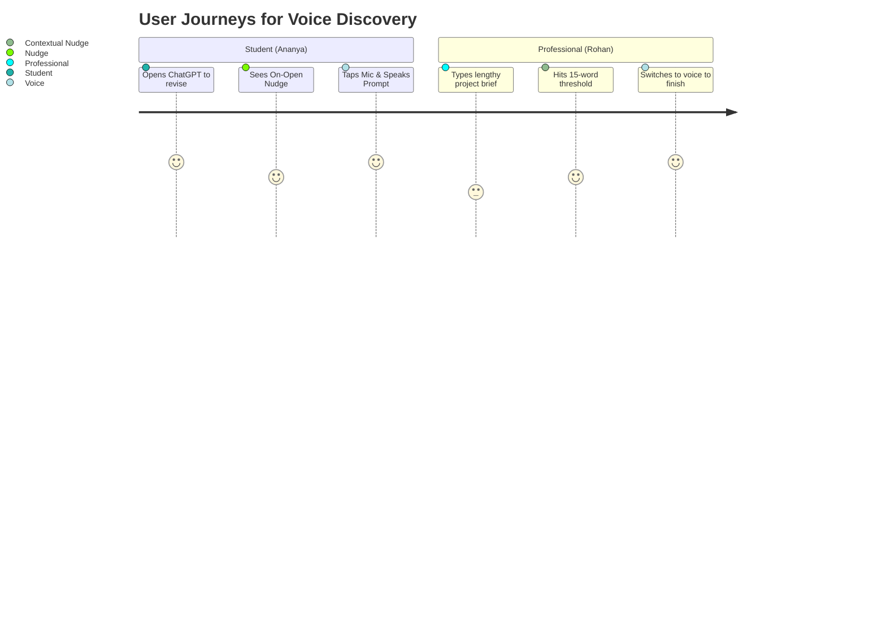
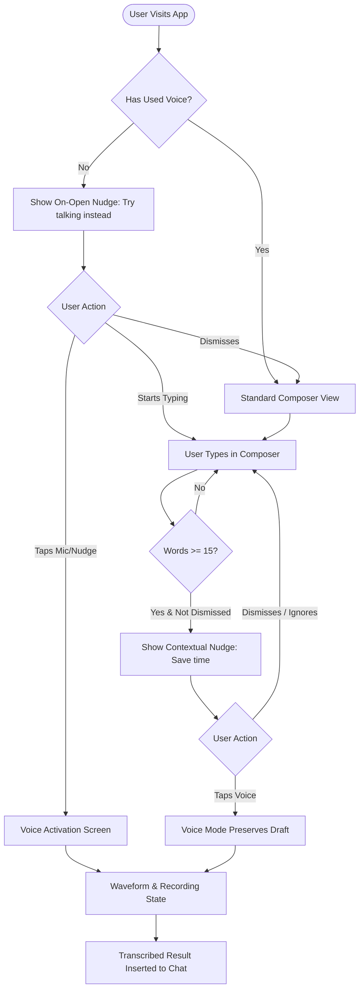
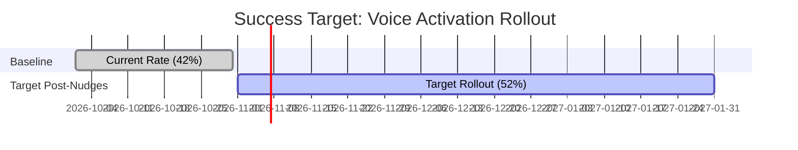

# Problem Statement: ChatGPT Voice Discovery & Contextual Activation Prototype

> [!IMPORTANT]
> **Project Target:** Build a lightweight, unified full-stack web prototype that demonstrates proactive and contextual voice discovery mechanisms in a ChatGPT-style interface, optimized for seamless single-click deployment on Vercel with minimal bundle footprint.
>
> **100% Free & Open-Source Guarantee:** Every single tool, framework, API, and hosting platform used is completely **FREE** ($0 cost, 0 subscriptions, 0 paid API keys like OpenAI keys, and 0 credit cards required).

---

## 1. Executive Summary & Project Metadata

| Attribute | Specification |
| :--- | :--- |
| **Project Title** | ChatGPT Voice Discovery & Activation Prototype |
| **Product Target** | ChatGPT Web & Mobile Conversational Interface |
| **Key Capability** | Contextual & Proactive Voice Nudges (On-Open & Typing-Triggered) |
| **Primary Objective** | Increase discovery and first-time trial of Voice Input among existing text-first users |
| **Target Deployment** | Single unified codebase (Frontend + lightweight API/Serverless) deployable on **Vercel** with minimal package size |
| **Cost & Licensing** | **100% Free & Open-Source Stack** (Zero dollar cost, no paid APIs) |
| **Target KPI** | Increase voice activation rate from **42% to 52%** within 3 months post-rollout |

ChatGPT users currently possess powerful multimodal interaction capabilities, notably voice dictation and conversational audio. However, a significant gap exists between feature availability and user adoption. While voice provides immense speed and hands-free convenience, many users either do not know the feature exists, forget it is an option, or default to typing out of muscle memory.

This project outlines the end-to-end problem definition, functional requirements, architectural blueprints, and UX specifications for building a high-fidelity, interactive prototype demonstrating how intelligent, contextual nudges can bridge this adoption gap without interrupting standard chat workflows.

---

## 2. Background & Problem Analysis

### 2.1 Market & Behavioral Context
According to product research data summarized in the Product Requirements Document (PRD):
- **35% of surveyed ChatGPT users** were completely unaware that voice input was supported.
- Among the 65% who knew voice existed, **only 42% had ever attempted to use it at least once**.
- The majority of regular users remain locked into text-only habits even when composing extensive, multi-sentence prompts where speech would be 3x–4x faster.



### 2.2 Root Cause Analysis: The Three Core Friction Barriers



1. **Discoverability Deficit (Primary Focus):**
   - The microphone icon in the message composer is small and visually understated.
   - Users focused on entering their prompt rarely explore peripheral UI controls.
   - Traditional onboarding banners are easily ignored or dismissed.

2. **Typing Inertia & Cognitive Timing:**
   - Users decide how to interact before they open the app. By the time they have typed 20+ words, speaking would have saved significant time, but switching modalities mid-draft feels disruptive.

3. **Trust & Feedback Uncertainty:**
   - Users are hesitant to speak because they fear speech recognition errors, microphone permission friction, or losing their thought process without a visible safety net.

---

## 3. Product Vision & Goals

### 3.1 Core Objectives
1. **Unobtrusive Proactive Discovery:** Present contextual cues at the exact moment voice offers the highest leverage (at app launch for first-time users, and during lengthy typing sessions).
2. **Zero Draft Loss Guarantee:** Ensure that triggering or exploring voice never clears, replaces, or endangers existing text entered in the composer.
3. **Familiar ChatGPT Look & Feel:** Deliver an aesthetic and interaction model indistinguishable from OpenAI's flagship web/mobile application.
4. **Interactive Reviewer Sandbox:** Equip reviewers, stakeholders, and testers with quick toggle controls to simulate first-time vs. returning users, trigger specific word thresholds, and inspect edge states.

### 3.2 Key Questions the Prototype Answers
- Can subtle micro-prompts draw attention to voice without feeling like intrusive spam?
- Does a 15-word typing threshold feel natural and helpful rather than distracting?
- Can users transition seamlessly into voice recording and back to text with zero friction?

---

## 4. Target User Personas



### Persona 1: Ananya (The Student)
- **Profile:** 20 years old, university student, studies between lectures, prepares flashcard queries and summaries.
- **Pain Point:** Frequently multitasks with textbooks or notes; typing repetitive questions on laptop/mobile is tedious.
- **Trigger:** On-open proactive nudge at session start.
- **Need:** *"I want to ask questions hands-free without navigating hidden menus or complex setups."*

### Persona 2: Rohan (The Multitasking Professional)
- **Profile:** 34 years old, product consultant, drafts complex analysis prompts, queries data, and brainstorms strategy.
- **Pain Point:** Frequently drafts long prompts (30–60 words) on mobile or laptop while juggling calls.
- **Trigger:** Contextual prompt triggered when typing reaches 15+ words.
- **Need:** *"I start typing out of habit, but when a prompt gets long, I need a quick nudge that lets me speak the rest effortlessly."*

### Persona 3: Priya (The Brainstormer & Commuter)
- **Profile:** 29 years old, creative marketer, uses ChatGPT during commutes and walks for ideation.
- **Pain Point:** Struggles with thumb-typing while on the move; needs immediate confidence that voice works reliably.
- **Trigger:** Mic highlight and immediate recording feedback with audio waveform.
- **Need:** *"I need an unmistakable, responsive voice mode with clear visual feedback that my voice is being captured."*

---

## 5. Proposed Solution & UX Specifications

The prototype introduces two intelligent discovery triggers paired with a fluid voice recording and confirmation interaction.

### 5.1 Solution A: On-Open Nudge (First-Time User Discovery)

| Property | Details |
| :--- | :--- |
| **Audience** | Existing ChatGPT users who have **never** activated voice input (`hasUsedVoice === false`) |
| **Trigger Point** | Fires immediately upon mounting the chat workspace (with a 400ms graceful entrance animation) |
| **Positioning** | Floats directly above/beside the microphone icon in the chat composer |
| **Exact Microcopy** | `"Try talking instead — just tap and speak."` |
| **Visual Treatment** | Pill-shaped dark tooltip with subtle pulse animation around the microphone icon |
| **Interactive Controls** | 1. Direct tap on Nudge or Mic opens Voice Activation.<br>2. Dismiss `(×)` icon removes the nudge cleanly.<br>3. Frequency capped: Dismissing sets `onOpenDismissed = true` so it does not loop. |

> [!NOTE]
> The On-Open Nudge does not shift composer layout or block user typing. Tapping into the textarea simply keeps the nudge accessible or auto-dismisses gracefully depending on user focus.

---

### 5.2 Solution B: Dynamic Contextual Nudge (15-Word Length Threshold)

| Property | Details |
| :--- | :--- |
| **Audience** | Any user typing an extended prompt who has not yet converted to voice in this session |
| **Trigger Condition** | Real-time word counter detects `words.length >= 15` in active composer draft |
| **Positioning** | Directly anchored above the right edge of the composer tray |
| **Exact Microcopy** | `"⚡ Save time — try talking instead."` |
| **Non-Destructive Behavior** | The typed draft remains 100% intact. Tapping voice offers the option to append spoken text or transition to full voice conversation. |
| **Dismissal & Hysteresis** | Can be dismissed with a single click. Once dismissed for this draft, it will not re-trigger even if word count fluctuates around 15. |

---

### 5.3 Solution C: Voice Activation & Recording Experience

When a user taps either the nudge or the mic button:
1. **Permission Simulation:** Displays a realistic browser microphone access check with clear feedback.
2. **Active Audio Waveform:** Renders dynamic canvas/CSS audio visualizer waves to confirm speech reception.
3. **Live Transcription Simulation:** Generates progressive speech-to-text preview so the user feels in control.
4. **Safe Controls:**
   - **Finish / Send (`✓`):** Submits the transcribed audio prompt directly to the chat stream.
   - **Cancel (`×`):** Returns the user to the text composer with their original draft preserved intact.
   - **Switch to Text:** Seamless transition back to manual editing.

---

## 6. Functional Requirements Matrix



| ID | Requirement Title | Detailed Specification | Priority |
| :--- | :--- | :--- | :--- |
| **FR-1** | **User State Simulation** | Provide reactive local state tracking: `hasUsedVoice`, `onOpenDismissed`, `contextualDismissed`, `activePersona`, and `sessionWordCount`. | `P0 (Must Have)` |
| **FR-2** | **On-Open Nudge Engine** | Automatically render the On-Open tooltip on initial load when `hasUsedVoice === false`. Include highlight pulse on mic button and clean dismiss `(×)`. | `P0 (Must Have)` |
| **FR-3** | **Real-Time Word Counter** | Count words dynamically using standard tokenization (`text.trim().split(/\s+/).filter(Boolean).length`). Trigger contextual nudge at exactly 15 words. | `P0 (Must Have)` |
| **FR-4** | **Draft Preservation** | Entering voice mode, switching states, or dismissing nudges must never clear or erase the user's active draft. | `P0 (Must Have)` |
| **FR-5** | **Interactive Voice Screen** | Modal / overlay or embedded state displaying animated audio waveform, timer, simulated speech transcript, and Send/Cancel actions. | `P0 (Must Have)` |
| **FR-6** | **Simulated AI Responses** | Provide realistic streaming ChatGPT responses to spoken and typed prompts to complete the interaction loop. | `P1 (Should Have)` |
| **FR-7** | **Reviewer Sandbox Toolbar** | A floating, collapsible control dock allowing reviewers to: reset all states, force first-time mode, force returning mode, autofill 15+ words, and toggle dark/light theme. | `P0 (Must Have)` |
| **FR-8** | **Single-Bundle Vercel Deployability** | Unified client-side Next.js/Vite/Express architecture requiring zero external database, zero heavy ML binaries, and zero config for instant Vercel hosting. | `P0 (Must Have)` |

---

## 7. Non-Functional & UI/UX Requirements

### 7.1 Visual Design Language (ChatGPT High-Fidelity)
- **Design System:** OpenAI-inspired minimalist dark/light mode palette.
  - Backgrounds: `#212121` (Main), `#171717` (Sidebar/Modals), `#2f2f2f` (Input field & cards).
  - Accents: Emerald `#10a37f` (Success/AI), Sleek Neutral `#ececec` (Text Primary), `#b4b4b4` (Muted).
- **Typography:** Inter, Outfit, or system-ui sans-serif with crisp font rendering and proper line heights.
- **Micro-Animations:**
  - Smooth spring transitions for tooltips (`cubic-bezier(0.16, 1, 0.3, 1)`).
  - Glowing radar pulse around the microphone button on first trigger.
  - Sine-wave audio visualizer during recording.

### 7.2 Performance & Bundle Size Constraints (Vercel-Optimized)
- **Zero Heavy Speech Models:** Use browser-native `webkitSpeechRecognition` / `MediaRecorder` API with a deterministic fallback simulation so the prototype runs flawlessly in any environment without downloading heavy model weights.
- **Ultra-Lightweight Footprint:** Total JavaScript bundle size under 150KB gzipped.
- **Zero Cold Start:** Instant client-side hydration with zero server latency.

---

## 8. Technical Architecture: Unified Full-Stack Vercel Blueprint

To fulfill the constraint in the problem brief (*"create backend and front end in one, so that i can upload in vercel in one go, the size should also be not too big"*):

```
milestone-3-chatgpt/
├── package.json               # Lightweight dependencies (React, Lucide icons, Vite)
├── vercel.json                # Zero-config Vercel deployment settings
├── index.html                 # HTML5 root with meta tags & Google fonts
├── api/                       # Vercel Serverless Functions (Optional mock backend)
│   └── chat.js                # Lightweight serverless completion endpoint
├── src/
│   ├── main.jsx               # Application entry point
│   ├── App.jsx                # Main layout coordinator
│   ├── index.css              # Curated design tokens & sleek dark mode
│   ├── components/
│   │   ├── ChatScreen.jsx             # Main conversation thread & history
│   │   ├── MessageComposer.jsx        # Textarea with auto-resize & mic anchor
│   │   ├── VoiceControl.jsx           # Pulsing mic button with state hooks
│   │   ├── OnOpenNudge.jsx            # Animated tooltip for first-time discovery
│   │   ├── ContextualNudge.jsx        # 15-word threshold tooltip
│   │   ├── VoiceActivationModal.jsx   # Full recording overlay with waveform
│   │   ├── AudioWaveform.jsx          # Live canvas/SVG dynamic soundwave
│   │   └── ReviewerSandbox.jsx        # Floating test dock for instant demo toggles
│   └── data/
│       └── mockConversations.js       # Pre-seeded student and professional threads
```

---

## 9. Success Metrics & Guardrail Framework



### 9.1 Primary KPI
- **Voice Activation Rate (VAR):** `(Users who activated voice ≥ 1 time) / (Total voice-aware users)`.
- **Target:** Elevate from **42% to 52%** within 90 days.

### 9.2 Secondary Metrics
- **Nudge Click-Through Rate (CTR):** Percentage of users who tap voice directly from On-Open and Contextual nudges.
- **Nudge Dismissal Rate:** Monitoring negative sentiment (target: < 15% immediate dismissals).
- **Prompt Completion Rate:** Percentage of users who complete speech capture and submit their query.

### 9.3 Quality Guardrails
- **Zero Input Disruption:** 0% occurrences of cleared or corrupted composer text when nudges appear.
- **Exposure Cap:** Never show the On-Open nudge to returning voice users. Limit contextual nudges to once per distinct message draft.

---

## 10. Acceptance Criteria Checklist

| Category | # | Acceptance Criteria | Verified |
| :--- | :--- | :--- | :---: |
| **Discovery** | 1 | On-Open nudge displays automatically for first-time voice users with copy: *"Try talking instead — just tap and speak."* | [ ] |
| **Discovery** | 2 | Voice microphone button pulses gently to establish clear visual hierarchy. | [ ] |
| **Typing** | 3 | Contextual nudge appears seamlessly the instant the composer text reaches 15 words with copy: *"Save time — try talking instead."* | [ ] |
| **Typing** | 4 | Contextual nudge does **not** trigger when draft is under 15 words. | [ ] |
| **Safety** | 5 | Dismissing either nudge does not delete or alter any typed characters in the composer. | [ ] |
| **Voice Mode** | 6 | Tapping voice opens the recording view with animated waveform and active state. | [ ] |
| **Voice Mode** | 7 | User can cancel back to typing or submit the voice query to receive simulated response. | [ ] |
| **Reviewer Tools**| 8 | Floating reviewer dock allows 1-click toggling between Persona states and quick reset. | [ ] |
| **Vercel / Build**| 9 | Codebase builds with 0 errors and deploys directly to Vercel via Git in under 60 seconds. | [ ] |

---

## 11. Next Implementation Steps

1. **Initialize Project Skeleton:** Set up Vite + React + Vanilla CSS design system with zero bloat.
2. **Build Chat & Composer UI:** Assemble responsive ChatGPT interface with dynamic word-counting hook.
3. **Implement Discovery Nudge Components:** Build `OnOpenNudge` and `ContextualNudge` with spring animations.
4. **Develop Voice Activation & Waveform:** Implement `AudioWaveform` with browser mic integration and simulated fallback.
5. **Integrate Reviewer Sandbox:** Add testing panel for rapid persona testing and instant verification.
6. **Vercel Deployment Verification:** Validate production build and package efficiency.
